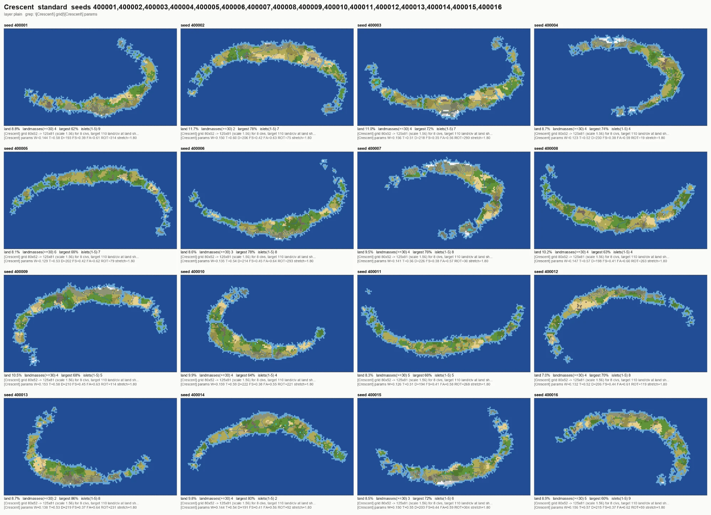
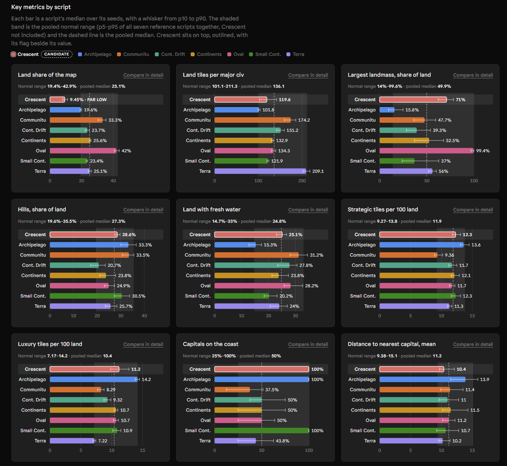
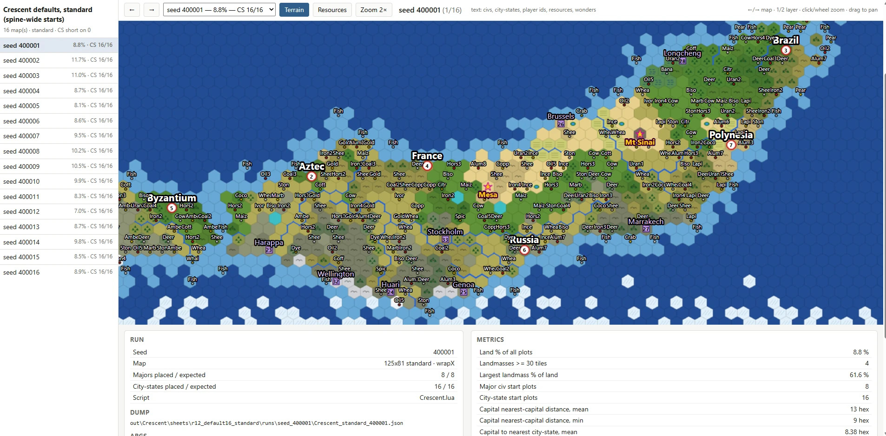

# c5-mdk: Civ 5 Map Development Kit (Vox Populi compatible)

Resources for agentic development of map scripts: write, run, render and sanity-check Civilization V
map scripts for [Vox Populi](https://github.com/LoneGazebo/Community-Patch-DLL) without launching
the game. The working directory and tool names use the shorter name `c5maps`.

Civ V map scripts are Lua files that the game's C++ engine calls at game start. Iterating on one
normally means starting a new game or driving WorldBuilder, and a single attempt costs minutes. This
repo replaces the game with a **fake client**: a pure-Lua 5.1 re-implementation of the engine
surface that map scripts touch (`Map`, `Plot`, `Area`, `Fractal`, the map RNG, `GameInfo`, players
and teams), ported line by line from the Community Patch DLL sources. It loads the real Vox Populi
and Community Patch Lua libraries in the game's own include order, runs any map script end to end,
dumps the result to JSON, and renders it as PNG, ASCII or an interactive HTML page. A standard-size
map takes 2 to 8 seconds.

Around that core sit the tools that make a new script *good*, not just runnable: a metrics module,
measured baselines from seven community reference scripts, a contact-sheet runner for shape review,
an explorer for start plots and resources, a compatibility sweep of every installed script, and a
Claude Skill plus a 2000-line authoring guide so an AI agent can do the whole loop autonomously.

## What is in the box

- **Engine (`engine/`)**: bit-exact ports of `CvRandom` and `CvFractal`, hex geometry, river edge
  flags, areas, landmasses and lakes with Vox Populi's actual semantics (verified against a real
  headless game), `GameInfo` from a SQLite export of the game database, a headless player and team
  model, and `include()` over the mod virtual file system (base game, expansions, Community Patch,
  Vox Populi).
- **Runner (`host/c5gen.py`)**: run any installed script or a path, at any world size, seed, civ and
  city-state count, team layout, map option or harness-only `--define` knob; writes a JSON dump, a log
  with the script's own `print` output, and renders.
- **Renderer (`render/render_map.py`)**: PNG layers (terrain, plain, mask, areas, continents,
  elevation, resources, start bias), ASCII art, stats, and positioned label records for vector
  overlays.
- **Metrics and baselines (`host/metrics.py`, `host/benchmark.py`, `docs/metrics-baselines.*`)**:
  about 90 macro metrics per map, and p5 to p95 ranges measured over 700 runs of Communitu,
  Continental Drift, Continents, Small Continents, Terra, Oval and Archipelago at standard and huge.
- **Review tools (`host/sheet.py`, `host/explorer.py`)**: parallel multi-run contact sheets, and a
  one-map-at-a-time HTML explorer. See the next section.
- **Docs and skill**: `docs/mapscript-guide.md` (how generation works, how to write a script, what
  breaks under Vox Populi, gotchas, normal metric ranges), `docs/engine-api.md` (exact engine
  semantics), `docs/script-compat.md` (which of the 87 installed scripts run), and the
  `.claude/skills/c5-mapgen` skill with a working template script.

## The review loop: from a shape to a map that behaves like the ones people know

A map script is easy to make *run* and hard to make *normal*. Players have strong expectations set
by the standard scripts: how far apart capitals are, how many luxuries sit near a start, how hilly
land is, how much of the sea is coast. The kit grounds a new script against those expectations in
three views, each answering a different question. The screenshots below come from developing a
crescent-shaped map with the kit.

### 1. Shape at a glance: contact sheets

```bash
python host/sheet.py MyMap.lua --size standard --seeds 1,2,3,4,5,6,7,8
python host/sheet.py MyMap.lua --run "thin|--define W=0.10" --run "wide|--define W=0.18" --seeds 1,2,3
```



`host/sheet.py` runs one script many times in parallel (across seeds, map options, or `--define`
knob values) and composes the results into one PNG. Tiles use the `mask` layer, which shows only
water, flat land, hills and mountains with a white star on each capital, because a grid is for
judging landmass shape and capital spread and nothing else. Under each tile sit the shape metrics
that matter at this stage (land share, landmasses of 30 tiles or more, largest landmass share, islet
count) and any log lines you ask for with `--grep`, here the script's own fitted parameters. A failed
run becomes a red tile with its Lua error. This is where you tune the landform until every seed
looks like the map you meant, before anything downstream is worth looking at.

### 2. Numbers against the community: metrics and baselines

```bash
python host/metrics.py compare out/MyMap/MyMap_standard_1.json --archetype Continents
python host/benchmark.py --scripts MyMap.lua --sizes standard,huge --seeds 25 --workers 10 \
    --out out/bench_mymap --baseline out/bench_mymap/mymap-baselines.json
```



Every dump can be measured and compared with the seven reference scripts. `metrics.py compare`
flags each metric that falls outside the pooled p5 to p95 range of the reference set, and outside
the chosen archetype's own range. Once a script generates land reliably, `benchmark.py` runs it 25
times per size and writes percentiles in the same format as the reference baselines, and the result
is presented next to the seven archetypes as a marked candidate, as in the dashboard above: each
bar is a script's median with a p10 to p90 whisker, the shaded band is the pooled normal range, and
the candidate's flag sits beside its value.

The guide separates **invariant** metrics from **archetype-dependent** ones, and that distinction
is what makes the comparison useful rather than nagging. Capital spacing, three luxuries at every
capital, the capital-to-city-state distance, strategic density, natural wonder counts and the
climate-band latitudes are produced by Vox Populi's start-plot library and are nearly identical
across all seven reference scripts. If a new script misses one of those, it is a bug. Land share,
landmass count, coastal capitals and coast-versus-ocean share differ widely between archetypes and
are design choices; the dashboard above shows the candidate's land share flagged far low on
purpose, because a crescent scales its grid up instead of filling it. The reference set spans the
archetype space on those axes (Oval is one landmass with 42 % land, Archipelago is islands with 20 %),
so a new design can usually point at the archetype it resembles and be judged against that.

### 3. Starts, city-states and resources: the explorer

```bash
python host/sheet.py MyMap.lua --size standard --seeds 1,2,3,4 --explorer
python host/explorer.py --runs out/sheets/MyMap_standard_seeds1-2-3-4 --embed
```



Everything a grid hides at tile scale is reviewed one map at a time in `explorer.html`: full-size
terrain and resources layers, capital and city-state markers with names, resource and natural
wonder labels drawn as a sharp vector overlay that hides label classes too small to read at the
current zoom, arrow keys between maps, and a caption with the seed, the arguments, the script's own
parameter lines and the full metric set. The map list shows city-states placed against the number
expected and turns red when the start-plot library could not fit them, the most common symptom of
land that looks fine but is too thin or too fragmented for Vox Populi's placement rules. The page is
self-contained and works from a `file://` URL, and `--embed` inlines the images for a one-file
handoff.

The three views are meant to be used in that order and repeated: shape until the sheets look right,
numbers to find what is structurally off, the explorer to understand why, then back to the script.
The same loop is what the Claude Skill follows when an agent writes a script.

## Requirements and setup

- Windows with Civilization V installed, Vox Populi and the Community Patch in
  `My Games\Sid Meier's Civilization 5\MODS`, and a game database cache from at least one Vox
  Populi game (`cache\Civ5DebugDatabase.db`).
- Python 3.11 with `lupa` (Lua 5.1 runtime) and `Pillow`.
- Optional: the Community-Patch-DLL source repository, only as a reference when porting engine
  behaviour.

Paths live in `host/paths.py` and can be overridden with `C5MAPS_*` environment variables.
`python host/gamedb.py --force` rebuilds the database export in `engine/data/` after a mod update.

## Quickstart

```bash
python host/c5gen.py --list-scripts                                  # every script found, with its source tag
python host/c5gen.py Continents --seed 42 --png --ascii              # -> out/Continents/Continents_standard_42.*
python host/c5gen.py vp:Communitu_79a --size huge --seed 3 --png     # tag picks a specific copy
python host/c5gen.py vp:Terra --list-options                         # the script's CustomOptions
python host/c5gen.py vp:Terra --option 4=1 --png                     # set option 4 to value 1 (1-based)
python host/c5gen.py exp1:Hemispheres --teams 2 --png                # team scripts need teams
python host/c5gen.py MyMap.lua --define W=0.14 --define T=0.6 --png  # harness-only knobs, nil in game
python host/metrics.py compare out/Continents/Continents_standard_42.json --archetype Continents
python render/render_map.py out/Continents/Continents_standard_42.json --layer areas
```

To write a new script, start from `.claude/skills/c5-mapgen/templates/Template_Map.lua`, which
runs end to end as is and shows every hook Vox Populi expects. Read the guide's opening overview
chapter for how the generation pipeline fits together, then `.claude/skills/c5-mapgen/SKILL.md`
for the workflow and the top gotchas.

## Repository layout

| Path | Contents |
|---|---|
| `host/` | `c5gen.py` (runner), `metrics.py` (metrics and baseline compare), `benchmark.py` (multi-seed baselines), `sheet.py` (contact sheets), `explorer.py` (HTML explorer), `gamedb.py` (DB export), `paths.py` |
| `engine/` | The fake client in pure Lua 5.1; `engine/data/` is the generated DB export |
| `render/` | `render_map.py`: PNG and ASCII renders of a dump, several layers, label records |
| `tests/` | Lua engine tests, CLI, render, metrics, sheet and explorer tests, quick and full script sweeps, the real-game area fixture and probe |
| `docs/` | Reference documentation (below) and the screenshots used here |
| `.claude/skills/c5-mapgen/` | The Claude Skill and the template script |
| `out/` | Generated maps, logs and renders (gitignored) |

## Documentation

| File | What it covers |
|---|---|
| `docs/mapscript-guide.md` | Overview of the generation pipeline and how the seven archetypes differ at each stage; lifecycle, options, plot, terrain, river and feature generation; Vox Populi start plots and resources; patterns, gotchas, checklist, normal metric ranges |
| `docs/engine-api.md` | Exact semantics of every engine call scripts use, hex math, area, lake and river algorithms, implementation notes |
| `docs/script-compat.md` | Which of the 87 installed scripts run under Vox Populi, which fail and why, workarounds |
| `docs/metrics-baselines.md` | Measured metric ranges for the 7 reference scripts at standard and huge (raw percentiles in `.json`) |
| `docs/api-usage-matrix.md` | Which engine API each installed script uses |
| `DESIGN.md` | Harness architecture, dump JSON format, paths, conventions |

## Tests

```bash
python tests/run_lua_tests.py && python tests/test_cli.py && python tests/test_sweep_quick.py
python tests/test_metrics.py && python tests/test_render.py
python tests/test_areas_real.py       # engine areas vs a real Vox Populi game (fixture in tests/fixtures)
python tests/test_sheet.py && python tests/test_explorer.py
python tests/sweep.py                 # full compatibility sweep (slow); --write-compat regenerates docs/script-compat.md
python host/benchmark.py --seeds 50 --workers 10   # re-measure docs/metrics-baselines.json (~7 min)
```

## Fidelity and limits

The engine logic is ported line by line, and the pieces that matter most were checked against the
real game: the fractal and RNG are bit-exact, and the area, landmass and lake assignment of a real
Vox Populi Pangaea replayed through the engine matches on every plot. Lua `pairs()` order and
`table.sort` ties can still differ from the game's Havok Script, so the same seed is not guaranteed
to give the same map as in game. WorldBuilder-based scripts (`WB_Script_*`) need a pre-built map
file and are not supported. Always confirm a finished script in game.
